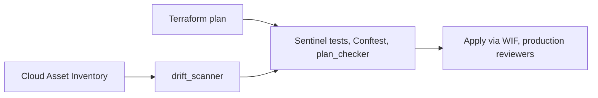

# guardrails-gcp

[](LICENSE)

A GCP landing zone in Terraform, gated by Sentinel and OPA in CI, with a drift scanner that turns a live finding into the next preventive policy.

Replace `GITHUB_ORG/REPO` in the CI badge after the repository is public:

`https://github.com/GITHUB_ORG/REPO/actions/workflows/ci.yml/badge.svg`

No stack in this repo has been applied. Validation is offline: `terraform validate`, policy unit tests, and committed plan fixtures.

## Architecture



The longer version, including hierarchy, network, and logging, is `docs/architecture.md`.

## What this demonstrates

| Area | Where |
|---|---|
| Org policy, IAM, VPC, logging, KMS, budgets | `landing-zone/` |
| Secure-by-default modules | `modules/` |
| Sentinel enforcement levels and mocks | `policies/sentinel/` |
| OPA CI gate | `policies/opa/` |
| Workload Identity Federation | `landing-zone/bootstrap/`, ADR 0003 |
| Detective to preventive loop | `tools/drift_scanner/`, ADR 0005 |
| FinOps and an agent threat model | `docs/finops.md`, `docs/threat-model-agentic-ai.md` |

## Quickstart

No cloud credentials.

```bash
python3 -m venv .venv
.venv/bin/pip install -r tools/requirements.txt
make test
make policy-demo
```

`make policy-demo` prints no findings for the compliant plan and fails the non-compliant plan on GCS-001, FW-001, LBL-001, VM-001, VM-002, IAM-001, and CMEK-001. Install Terraform, Sentinel, OPA, and Conftest first. Versions are in `docs/HANDOFF.md`. `make help` lists every target.

## Deploy

Follow `docs/runbook.md`. You create the project, authenticate, and apply. CI apply waits for GitHub Environment `production` and for WIF variables. Until those exist, the apply job skips.

## Cost and teardown

Data Access logs, flow logs, NAT, and CMEK are the line items. Read `docs/finops.md` before apply. Destroy in reverse stack order. `docs/runbook.md` covers retention locks and `prevent_destroy` on KMS keys.

## Screenshots

Capture these after the first real pull request. They are not in the repo yet.

- Failing `example-policy-demo` on `examples/non-compliant/open_ssh.tf`
- Green run on `examples/compliant`
- `make drift` report with a preventive gap on NET-002

## Repo tour

| Path | Contents |
|---|---|
| `landing-zone/` | Bootstrap, org policies, folders, network, logging, IAM, monitoring, FinOps, optional VPC-SC, optional Vertex workload |
| `modules/` | Bucket, instance, BigQuery, firewall, service account, KMS key |
| `policies/` | Sentinel and Rego |
| `tools/` | `plan_checker`, `drift_scanner` |
| `examples/` | One compliant stack and one violation per file |
| `queries/bigquery/` | Audit and billing SQL |
| `docs/` | ADRs, catalog, rollout, runbook, interview notes |

## Limitations

Sentinel is tested in CI and enforced only if you add HCP Terraform. Conftest is the gate that runs on GitHub. CMEK is advisory. VPC Service Controls are dry-run and off. The lab is one organization or one project, not 500. Details and the scaling notes are in `docs/interview-notes.md`.

## License

MIT. See `LICENSE`.
