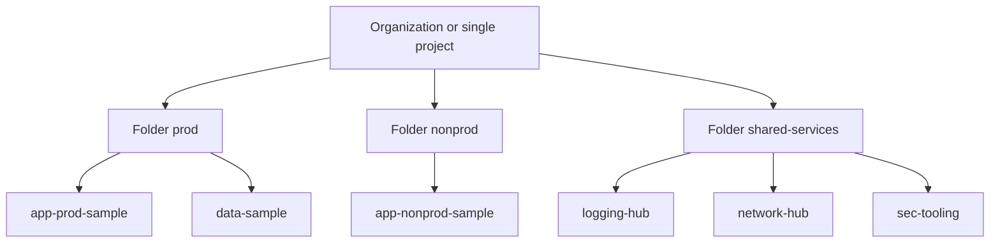
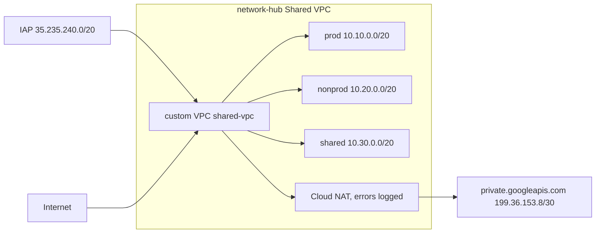
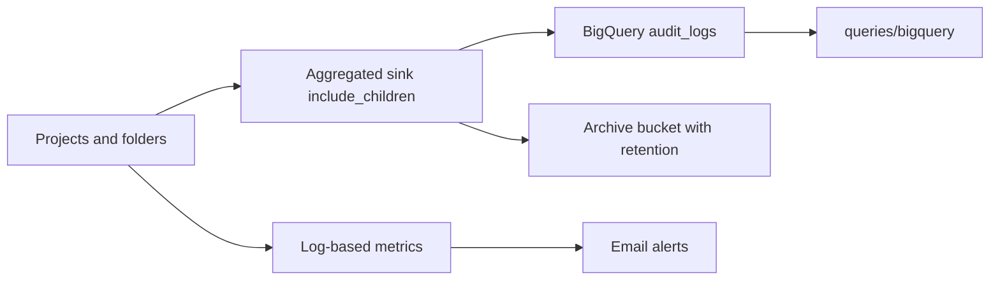
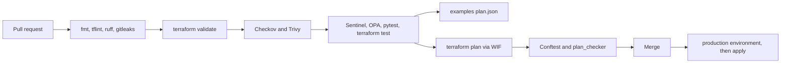
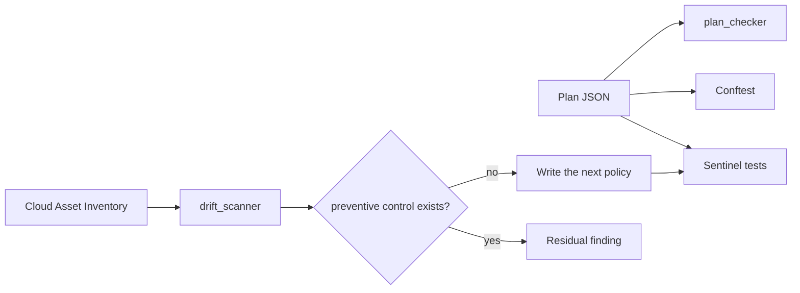

# Architecture

guardrails-gcp is a landing zone plus the checks that keep the next change inside it. Nothing in this repository has been applied to a live organization. `terraform validate`, policy tests, and the offline plan fixtures are the evidence.

## Resource hierarchy

When `scope_type` is `project`, the folders and extra projects are not created. Outputs alias the one project. See ADR 0004.

IAM inheritance is the risk in this picture. A binding on the organization applies to every folder and project under it. `roles/editor` at the org is editor on the logging sink and the data project. The IAM stack therefore binds groups to custom roles, adds one time-bound condition, and adds a deny policy for service-account key creation. Deny policies beat allow bindings, including inherited ones. Org policies are a third mechanism: they constrain the resource API, and they are not IAM.

## Network

Subnets have Private Google Access and VPC flow logs. The sampling rate defaults to 0.5 because full sampling is a cost choice (`docs/finops.md`).

The hierarchical firewall policy denies all ingress at priority 65534. The `firewall-rule` module then allows SSH and RDP only from the IAP range to the `iap-ssh` tag, and health checks only to the `lb-backend` tag. Egress allows RFC1918 and the private Google API range, then denies the rest when `restrict_egress` is true. OS package mirrors on the public internet do not work until someone adds an explicit allow or sets `restrict_egress` to false. That tradeoff is in `landing-zone/20-network/README.md`.

A private DNS zone for `googleapis.com` points at `199.36.153.8`–`199.36.153.11` so clients resolve the private VIP. Private Service Connect is the alternative when a producer service publishes an endpoint; this lab uses the private VIP plus NAT.

### Firewall rules versus VPC Service Controls

A firewall rule filters packets by IP, port, and tag. It does not know that a call is `storage.objects.get`. VPC Service Controls draws a perimeter around projects and APIs. A stolen token used from outside the perimeter fails even when the packet is allowed and IAM would allow the call. `landing-zone/70-vpc-sc` is dry-run and off by default: `use_explicit_dry_run_spec` with no `status` block, so nothing is enforced until a human copies the spec into status after reading the dry-run logs.

## Logging

Admin Activity audit logs are on by default and cannot be turned off. Data Access logs (ADMIN_READ, DATA_READ, DATA_WRITE) are off until `landing-zone/30-logging` configures `allServices`. They are the expensive ones. `audit_exempted_members` and exclusion filters exist so a lab can drop high-volume read noise. The archive bucket has a retention policy. Locking it is irreversible, so `lock_retention` defaults to false.

### Logging and query practice

The six SQL files are SIEM-style detections written as SQL because the sink destination is BigQuery:

| Detection idea | File |
|---|---|
| Who changed IAM | `iam_policy_changes.sql` |
| A firewall opened toward the world | `firewall_world_ingress.sql` |
| Someone created a key | `service_account_key_creations.sql` |
| What is being denied, and by whom | `top_permission_denied.sql` |
| Unusual reads of a sensitive dataset | `sensitive_data_reads.sql` |
| Org Policy drift over time | `org_policy_changes.sql` |

The same questions in a vendor query language are a filter, an aggregation, and a time window. In XQL-style thinking that is roughly: filter the dataset to the last 7 days, keep `SetIamPolicy`, aggregate by principal. The SQL equivalent is the `WHERE` plus `GROUP BY` in those files. Practice the vendor syntax in Palo Alto's XQL documentation; this repo keeps the logic in SQL so it runs on the sink this landing zone actually creates.

## CI/CD

The plan and apply jobs no-op until WIF variables exist. The example demo does not need them. Apply uses a GitHub Environment named `production`. Reviewers are configured in GitHub, not in Terraform.

## Preventive and detective loop

IAM-003 is the closed loop: a live user-managed key became an org policy plus a hard-mandatory plan rule. NET-002, flow logs disabled, is the open gap. ADR 0005 records both.
